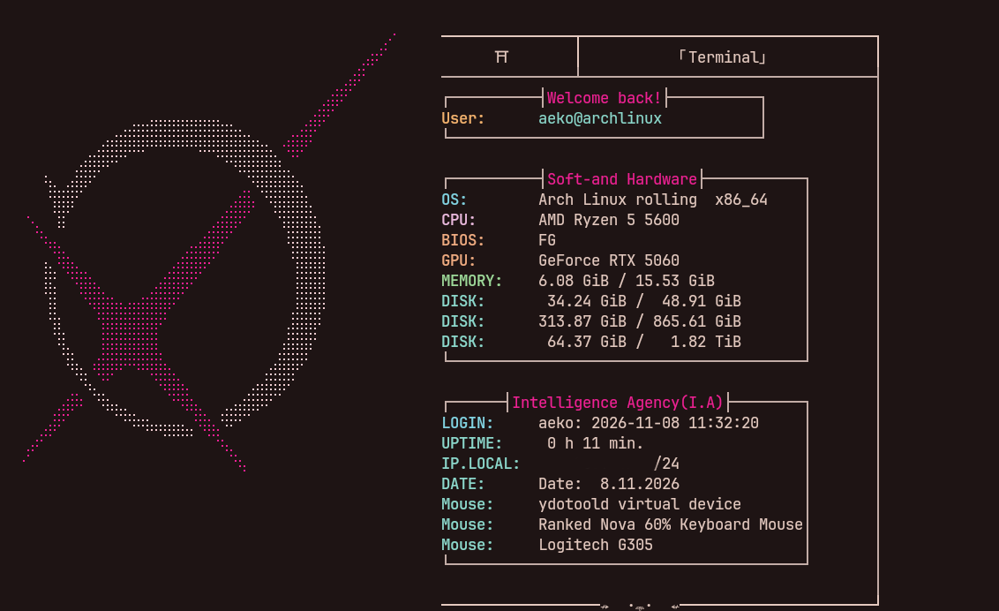
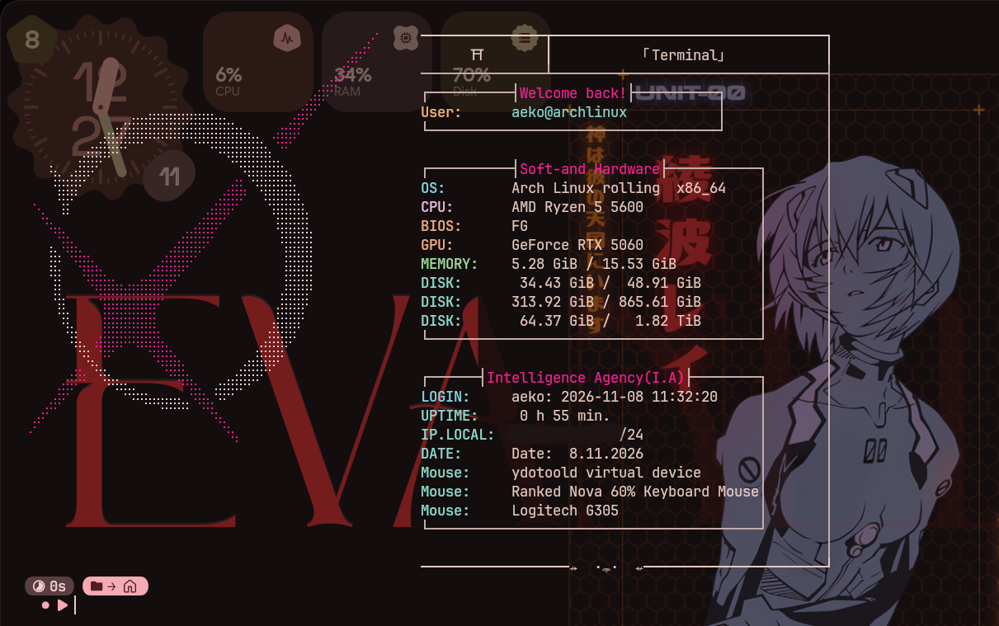

# blade-fetch

A [fastfetch](https://github.com/fastfetch-cli/fastfetch) config with a pink-and-white ASCII logo and a framed layout.




## Install

```bash
curl -fsSL https://raw.githubusercontent.com/AEKO-kl/blade-fetch/main/install.sh | bash
```

Your current `~/.config/fastfetch` is moved to `~/.config/fastfetch.bak.<timestamp>` before anything is installed, so nothing is lost. Works from bash, zsh or fish.

Read the script before running it: [install.sh](install.sh).

## Requirements

- `fastfetch`, `git`, `curl`
- A terminal with 24-bit color support (kitty, alacritty, ...)
- A font that renders braille characters and box-drawing symbols (any Nerd Font works)

On Arch: `sudo pacman -S fastfetch git curl`

## Run it at every terminal start

Add `fastfetch` at the end of your shell config:

- fish: `~/.config/fish/config.fish`
- bash: `~/.bashrc`
- zsh: `~/.zshrc`

## Restore your old config

```bash
rm -rf ~/.config/fastfetch
mv ~/.config/fastfetch.bak.<timestamp> ~/.config/fastfetch
```

## Customize

- `fastfetch/ascii.txt`: the logo, with ANSI color codes. Edit it with `cp`, not by copy-pasting text, or the invisible escape characters are lost.
- `fastfetch/config.jsonc`: modules, colors and frame layout.


## Transparent terminal (optional, kitty)





Install the transparancy,(default 0.6 opacity)

```bash
curl -fsSL https://raw.githubusercontent.com/AEKO-kl/blade-fetch/main/transparency.sh | bash
```

Choose the opacity (1 = opaque, 0.5 = very transparent):

```bash
curl -fsSL https://raw.githubusercontent.com/AEKO-kl/blade-fetch/main/transparency.sh | bash -s -- 0.74
```

Remove it:

```bash
curl -fsSL https://raw.githubusercontent.com/AEKO-kl/blade-fetch/main/transparency.sh | bash -s -- --off
```

Your `kitty.conf` is backed up before each change. With `dynamic_background_opacity` enabled you can also change the opacity live: `Ctrl+Shift+A` then `M` / `L` (more / less opaque).

